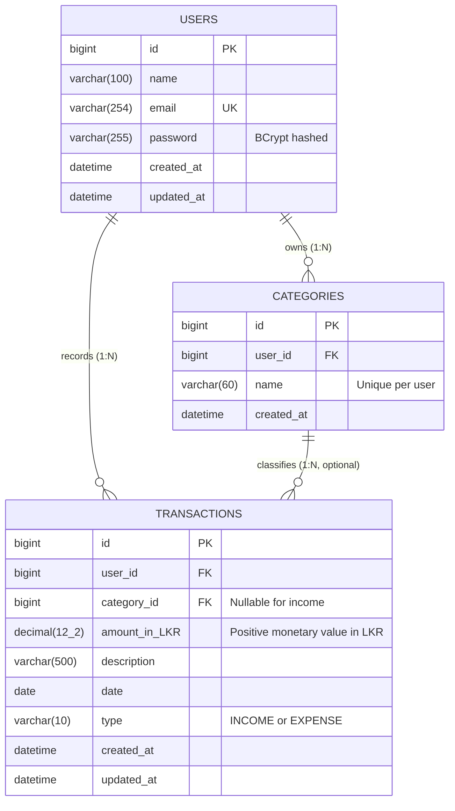

# Finora — Personal Expense Tracker

Finora is a full-stack personal finance tracking application designed for coursework evaluation and practical daily expense monitoring. It provides authenticated personal workspaces, relational category management, transaction tracking with real-time filtering/sorting/pagination, visual financial analytics, and period-based reporting.

---

## Table of Contents

1. [Features](#features)
2. [Technology Stack](#technology-stack)
3. [System Architecture](#system-architecture)
4. [Entity Relationship Diagram (ERD)](#entity-relationship-diagram-erd)
5. [Project Structure](#project-structure)
6. [Prerequisites](#prerequisites)
7. [Local Setup & Run Commands](#local-setup--run-commands)
8. [Quality Checks & Automated Tests](#quality-checks--automated-tests)
9. [REST API Endpoints](#rest-api-endpoints)
10. [Academic Rubric Alignment](#academic-rubric-alignment)
11. [Known Limitations](#known-limitations)

---

## Features

- **Authentication & Security:** User registration and sign-in with BCrypt password hashing, stateless JWT bearer token authentication, and multi-tenant data isolation.
- **Transactions CRUD:** Create, read, update, and delete income and expense records with monetary precision (`amount_in_LKR DECIMAL(12,2)`), search, date filters, 4-way sorting, and pagination.
- **Category Management:** User-owned categories with duplicate name prevention (case-insensitive) and relational integrity safeguards preventing deletion of categories with linked transactions.
- **Dashboard & Cash Flow:** Financial summary KPI cards (Total Balance, Total Income, Total Expenses, Monthly Savings Rate), monthly income vs. expense comparison bar chart, and spending-by-category breakdown donut chart.
- **Reports & Export:** Period-based financial recaps (monthly and custom date ranges), category breakdown progress bars, browser Print/Save PDF support, and CSV export.
- **User Experience & Currency Conversion:** Professional financial UI design system, accessible light and dark themes, mobile-responsive navigation drawer, and real-time multi-currency conversion (LKR, USD, EUR, GBP) using standard exchange rates with automatic base-currency persistence.

---

## Technology Stack

| Layer | Technologies | Purpose |
|---|---|---|
| **Frontend** | React 18, Vite 6, Axios, Lucide Icons, CSS3 | Single-page application, responsive layout, and REST API client |
| **Backend** | Java 21, Spring Boot 3.5, Spring Security, Spring Data JPA | REST API, validation, business rules, and security enforcement |
| **Database** | MySQL 8, Flyway | Relational persistence and automated schema migrations |
| **Testing** | Vitest, React Testing Library, JUnit 5, H2 Database | Unit, component, and multi-tenant isolation tests |

---

## System Architecture

```text
┌──────────────────────────────────────────────────────────────┐
│                     Client Tier (Browser)                    │
│  React 18 + Vite SPA  ──  Axios HTTP Client  ──  Bearer JWT │
└──────────────────────────────┬───────────────────────────────┘
                               │ JSON over HTTP (Port 8080)
                               ▼
┌──────────────────────────────────────────────────────────────┐
│                    API Tier (Spring Boot)                    │
│  Security Filter Chain (JWT Validator & UserContext)         │
│  Controllers (Validation, HTTP Mapping, OpenAPI Docs)        │
│  Services (Business Rules, Calculation, Tenant Scoping)      │
│  Spring Data JPA Repositories                                │
└──────────────────────────────┬───────────────────────────────┘
                               │ JDBC (Port 3306)
                               ▼
┌──────────────────────────────────────────────────────────────┐
│                   Data Tier (MySQL 8)                        │
│  Flyway Schema (V1__init_schema.sql)                         │
│  Tables: users, categories, transactions                     │
└──────────────────────────────────────────────────────────────┘
```

---

## Entity Relationship Diagram (ERD)

The database schema enforces user ownership, referential integrity, and monetary precision:



### Relational Constraints

1. **`users`:** `id` is primary key; `email` has a unique constraint (`uk_users_email`).
2. **`categories`:** `user_id` foreign key references `users(id)` with `ON DELETE CASCADE`. The composite unique index (`uk_category_name_per_user`) prevents duplicate category names under the same account.
3. **`transactions`:** `user_id` foreign key references `users(id)` with `ON DELETE CASCADE`. `category_id` references `categories(id)` with `ON DELETE RESTRICT` (a category with recorded transactions cannot be deleted).

---

## Project Structure

```text
├── Back-End/expense-tracker/          # Spring Boot 3.5 REST API
│   ├── src/main/java/                 # Controllers, Services, Entities, Repositories, DTOs
│   ├── src/main/resources/            # application.properties & Flyway migrations
│   ├── src/test/java/                 # JUnit 5 & H2 Integration tests
│   ├── pom.xml                        # Maven dependencies & build configuration
│   └── mvnw.cmd                       # Maven wrapper script
├── Front-End/                         # React 18 + Vite frontend
│   ├── src/components/                # Dashboard, Transactions, Categories, Reports, Auth
│   ├── src/context/                   # AuthContext (session, login, register, profile)
│   ├── src/hooks/                     # useFinanceData (state management & caching)
│   ├── src/services/                  # Axios HTTP service layer
│   ├── src/utils/                     # Currency, date, validation, and CSV export utilities
│   ├── src/__tests__/                 # Vitest & Testing Library component/unit tests
│   └── styles.css                     # Unified design system & responsive styling
└── README.md                          # Repository documentation & guide
```

---

## Prerequisites

- **Java:** JDK 21 or later
- **Database:** MySQL Server 8.0+
- **Node.js:** Node.js 20 or later with npm

---

## Local Setup & Run Commands

### 1. Database Setup (MySQL)

Start your local MySQL service and create the application database:

```powershell
mysql -u root -p -e "CREATE DATABASE IF NOT EXISTS expense_tracker CHARACTER SET utf8mb4 COLLATE utf8mb4_unicode_ci;"
```

### 2. Backend Setup (Spring Boot)

In a PowerShell terminal from the project root:

```powershell
Set-Location .\Back-End\expense-tracker

# Configure environment variables (or copy .env.example)
$env:DB_URL = "jdbc:mysql://localhost:3306/expense_tracker?createDatabaseIfNotExist=true"
$env:DB_USERNAME = "root"
$env:DB_PASSWORD = "your-local-mysql-password"
$env:JWT_SECRET = "finora-development-jwt-secret-key-32-bytes-minimum-length-for-hmac-sha256"

# Run Spring Boot
.\mvnw.cmd spring-boot:run
```

- API Base URL: `http://localhost:8080/api`
- Swagger UI / OpenAPI Docs: `http://localhost:8080/swagger-ui.html`

### 3. Frontend Setup (React + Vite)

In a second PowerShell terminal from the project root:

```powershell
Set-Location .\Front-End

# Install dependencies using the verified lockfile
npm ci

# Start local Vite development server
npm run dev
```

- Web Application: `http://localhost:5173`

---

## Quality Checks & Automated Tests

All tests run locally in isolated environments without modifying your local MySQL database.

```powershell
# 1. Frontend Unit & Component Tests (39 passed across 6 test suites)
npm --prefix Front-End run test

# 2. Frontend ESLint Static Analysis (0 errors)
npm --prefix Front-End run lint

# 3. Frontend Production Build Check
npm --prefix Front-End run build

# 4. Backend Integration & Unit Tests (29 passed, 0 failures using H2 in-memory DB)
.\Back-End\expense-tracker\mvnw.cmd -f .\Back-End\expense-tracker\pom.xml test
```

---

## REST API Endpoints

All responses return standard JSON. Protected endpoints require the header `Authorization: Bearer <JWT>`.

| Method | Endpoint | Auth | Purpose |
|---|---|---|---|
| `POST` | `/api/auth/register` | Public | Register new user account |
| `POST` | `/api/auth/login` | Public | Authenticate user and receive JWT bearer token |
| `GET` | `/api/auth/me` | Bearer | Retrieve current authenticated user profile |
| `PUT` | `/api/auth/me` | Bearer | Update profile name and email |
| `GET` | `/api/categories` | Bearer | List categories owned by authenticated user |
| `POST` | `/api/categories` | Bearer | Create category (unique name validated per user) |
| `PUT` | `/api/categories/{id}` | Bearer | Update category name |
| `DELETE` | `/api/categories/{id}` | Bearer | Delete category (blocked if referenced by transactions) |
| `GET` | `/api/transactions` | Bearer | List, filter (date, type, category, search), and sort |
| `GET` | `/api/transactions/paged` | Bearer | Paginated, filtered, and sorted transactions |
| `POST` | `/api/transactions` | Bearer | Create income/expense transaction with Bean Validation |
| `PUT` | `/api/transactions/{id}` | Bearer | Update transaction details |
| `DELETE` | `/api/transactions/{id}` | Bearer | Delete transaction |
| `GET` | `/api/dashboard/summary` | Bearer | Get lifetime & monthly totals (income, expenses, balance) |
| `GET` | `/api/dashboard/recent-transactions` | Bearer | Retrieve latest 5 transactions |
| `GET` | `/api/dashboard/category-expenses` | Bearer | Monthly spending grouped by category |
| `GET` | `/api/reports/monthly` | Bearer | Monthly financial calculation report |
| `GET` | `/api/reports/date-range` | Bearer | Custom date range report summary |
| `GET` | `/api/reports/category` | Bearer | Expense breakdown by category for date range |

---

## Academic Rubric Alignment

| Rubric Criterion | Implementation Evidence | Test Verification |
|---|---|---|
| **Create** | TransactionModal & CategoryModal submit to POST endpoints with DTO validation. | Tested in `TransactionServiceImplTest`, `CategoryServiceImplTest`. |
| **Read** | Multi-view data presentation: Dashboard KPIs, Transactions table, Categories grid, Reports. | Tested in `TransactionsPage.test.jsx`, `Dashboard.test.jsx`. |
| **Update** | Edit transactions, category names, and profile information via PUT endpoints. | Tested in `TransactionServiceImplTest`, `CategoryServiceImplTest`. |
| **Delete** | Delete transactions and categories with user confirmation dialogs and integrity guards. | Verified in `TransactionServiceImplTest`, `CategoryServiceImplTest`. |
| **Validation & Error Handling** | Client-side validation + Jakarta Bean Validation on request DTOs; consistent JSON error bodies. | Tested in `validation.test.js`, `CategoryServiceImplTest`. |
| **Database Design** | 3 normalized tables, foreign keys, unique indexes, decimal precision, Flyway migrations. | Verified via `V1__init_schema.sql` and Hibernate JPA mappings. |
| **UI/UX & Responsiveness** | Professional finance design system, accessible light/dark theme, mobile navigation drawer. | Tested across desktop, tablet, and mobile breakpoints; verified with ESLint & Vite build. |
| **Security & Isolation** | Spring Security JWT authentication filter, BCrypt hashing, multi-tenant query scoping. | Tested in `UserIsolationIntegrationTest` and `TransactionSecurityTest`. |
| **Documentation & API Specs** | Comprehensive README, Mermaid ERD, and interactive Swagger UI / OpenAPI documentation. | Verified via `/swagger-ui.html` and README documentation. |

---

## Known Limitations

- **External Banking Feeds:** Financial records are entered and managed directly by users; third-party live bank syncing (e.g., Plaid / Open Banking API) is omitted to keep the application self-contained.
- **Password Reset via Email:** Outbound SMTP email services and tokenized password reset links are omitted to maintain a self-contained local evaluation environment without external mail credentials.
- **Exchange Rate Source:** Currency conversion utilizes standardized fixed exchange rates relative to base currency (LKR); automated dynamic live Forex API polling is not configured.
