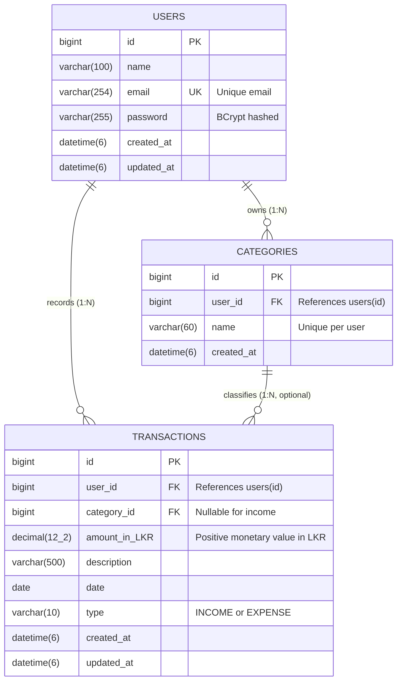

# Finora — Personal Expense Tracker

Finora is a full-stack personal finance tracking application designed for coursework evaluation and practical daily expense monitoring. It provides authenticated personal workspaces, relational category management, transaction tracking with filtering/sorting/pagination, visual financial analytics, period-based reporting, CSV export, accessible light/dark themes, and fixed-rate multi-currency conversion.

---

## Architecture Sub-Readmes

For detailed tier-specific guides, refer directly to the dedicated documentation:

- 🖥️ **[Frontend Documentation](Front-End/README.md)** — React 18, Vite 6, Axios, Lucide Icons, styling system, Vitest component tests, and frontend build commands.
- ⚙️ **[Backend Documentation](Back-End/expense-tracker/README.md)** — Spring Boot 3.5 REST API, Spring Security, JWT authentication, Flyway migrations, MySQL configuration, and integration tests.

---

## Table of Contents

1. [Features](#features)
2. [Technology Stack](#technology-stack)
3. [System Architecture](#system-architecture)
4. [Entity Relationship Diagram (ERD)](#entity-relationship-diagram-erd)
5. [Database Migrations & Hibernate](#database-migrations--hibernate)
6. [Project Structure](#project-structure)
7. [Prerequisites](#prerequisites)
8. [Environment Variables & Security](#environment-variables--security)
9. [Local Setup & Run Commands](#local-setup--run-commands)
10. [Quality Checks & Automated Tests](#quality-checks--automated-tests)
11. [REST API Endpoints](#rest-api-endpoints)
12. [Academic Rubric Alignment](#academic-rubric-alignment)
13. [Known Limitations & Troubleshooting](#known-limitations--troubleshooting)

---

## Features

- **Authentication & Security:** User registration and sign-in with BCrypt password hashing, stateless JWT bearer token authentication, and multi-tenant data isolation preventing unauthorized cross-user access.
- **Transactions CRUD:** Create, read, update, and delete income and expense records with monetary precision in base currency (`amount_in_LKR DECIMAL(12,2)`), search keyword matching, date range filters, 4-way sorting, and paginated queries.
- **Category Management:** User-owned categories with duplicate name prevention (case-insensitive per user) and relational integrity safeguards preventing deletion of categories with linked transactions (`ON DELETE RESTRICT`).
- **Dashboard & Cash Flow:** Summary KPI cards (Total Balance, Total Income, Total Expenses, Monthly Savings Rate), monthly income vs. expense comparison bar chart, and spending-by-category breakdown donut chart.
- **Reports & Export:** Period-based financial recaps (monthly and custom date ranges), category breakdown progress bars, browser Print/Save PDF support, and CSV data export for transactions and financial recaps.
- **Fixed-Rate Multi-Currency Conversion:** Display currency options for Sri Lankan Rupee (LKR, `Rs.`), US Dollar (USD, `$`), Euro (EUR, `€`), and British Pound (GBP, `£`).
  - **Base Currency Persistence:** All transaction records are stored in the MySQL database in base currency (`LKR`) in the `amount_in_LKR` column.
  - **Dynamic Display Conversion:** Dashboard KPI cards, cash-flow bar charts, category breakdown donut charts, transaction tables, and reports dynamically convert values from base `LKR` into the user's active display currency.
  - **Input Conversion:** When entering or editing a transaction while viewing in a foreign currency (e.g. USD), the frontend converts the entered amount back to base `LKR` before submitting to the REST API.
  - **Standard Exchange Rates:** Uses verified fixed conversion rates (`1 USD = 300 LKR`, `1 EUR = 325 LKR`, `1 GBP = 380 LKR`, `1 LKR = 1 LKR`). Configured rates are fixed coursework standards and not guaranteed to reflect live Forex market rates.
- **User Interface & Accessibility:** Accessible light and dark themes, mobile-responsive layout with slide-out navigation drawer, semantic HTML, and clear loading/empty/error states.

---

## Technology Stack

| Layer | Technologies | Purpose |
|---|---|---|
| **Frontend** | React 18.3, Vite 6.0, Axios, Lucide Icons, Modern CSS3 | Single-page application, responsive layout, and REST API client |
| **Backend** | Java 21 (LTS), Spring Boot 3.5.6, Spring Security 6, Spring Data JPA | REST API, validation, business rules, security, and query processing |
| **Database** | MySQL 8.0, Flyway 11.7 | Relational persistence and automated, version-controlled schema migrations |
| **Frontend Testing** | Vitest 5.0, React Testing Library, JSDOM | Unit tests, utility tests, and component integration tests |
| **Backend Testing** | JUnit 5, Mockito, Spring Boot Test, H2 In-Memory Database | Controller, service, isolation, and security integration tests |

---

## System Architecture

```text
┌──────────────────────────────────────────────────────────────┐
│                     Client Tier (Browser)                    │
│  React 18 + Vite SPA  ──  Axios HTTP Client  ──  Bearer JWT │
└──────────────────────────────┬───────────────────────────────┘
                               │ JSON over HTTP (Port 8080)
                               ▼
┌──────────────────────────────────────────────────────────────┐
│                    API Tier (Spring Boot)                    │
│  Security Filter Chain (JWT Validator & UserContext)         │
│  Controllers (Validation, HTTP Mapping, OpenAPI Docs)        │
│  Services (Business Rules, Calculation, Tenant Scoping)      │
│  Spring Data JPA Repositories & Specifications               │
└──────────────────────────────┬───────────────────────────────┘
                               │ JDBC (Port 3306)
                               ▼
┌──────────────────────────────────────────────────────────────┐
│                   Data Tier (MySQL 8)                        │
│  Flyway Migrations (V1__init_schema, V2__rename_amount)      │
│  Tables: users, categories, transactions                     │
└──────────────────────────────────────────────────────────────┘
```

---

## Entity Relationship Diagram (ERD)

The database schema enforces user ownership, referential integrity, and monetary precision:



### Relational Constraints & Indexes

1. **`users` Table:**
   - Primary key: `id` (`BIGINT AUTO_INCREMENT`).
   - Unique constraint: `uk_users_email` on `email` column.
2. **`categories` Table:**
   - Primary key: `id` (`BIGINT AUTO_INCREMENT`).
   - Foreign key: `fk_categories_user` references `users(id)` with `ON DELETE CASCADE`.
   - Composite unique index: `uk_category_name_per_user` on `(user_id, name)` prevents duplicate category names under the same account.
3. **`transactions` Table:**
   - Primary key: `id` (`BIGINT AUTO_INCREMENT`).
   - Foreign key: `fk_transactions_user` references `users(id)` with `ON DELETE CASCADE`.
   - Foreign key: `fk_transactions_category` references `categories(id)` with `ON DELETE RESTRICT` (prevents deleting a category if linked transactions exist).
   - Compound index: `idx_transaction_user_date` on `(user_id, date)`.
   - Compound index: `idx_transaction_user_type_date` on `(user_id, type, date)`.
   - Index: `idx_transaction_category` on `(category_id)`.

---

## Database Migrations & Hibernate

The application uses **Flyway** for reproducible, version-controlled DDL migrations:

1. **`V1__init_schema.sql`:** Creates `users`, `categories`, and `transactions` tables with primary keys, foreign keys, unique constraints, and query performance indexes.
2. **`V2__rename_amount_to_amount_in_lkr.sql`:** Idempotently renames the transaction monetary column to `amount_in_LKR DECIMAL(12, 2) NOT NULL` to document base currency persistence.

### Hibernate vs. Flyway Configuration

In [`Back-End/expense-tracker/src/main/resources/application.properties`](Back-End/expense-tracker/src/main/resources/application.properties):

```properties
spring.flyway.enabled=${FLYWAY_ENABLED:true}
spring.jpa.hibernate.ddl-auto=${HIBERNATE_DDL_AUTO:update}
```

- **Development:** `HIBERNATE_DDL_AUTO=update` is used during local development to allow Hibernate to validate entities and incrementally synchronize entity changes alongside Flyway.
- **Production:** Best practice is to set `HIBERNATE_DDL_AUTO=validate` (or `none`) so that Flyway exclusively manages database evolution, and Hibernate strictly validates that JPA entity classes match the migrated schema without modifying table structures.

---

## Project Structure

```text
├── Back-End/expense-tracker/          # Spring Boot 3.5.6 REST API
│   ├── src/main/java/                 # Controllers, Services, Entities, Repositories, DTOs
│   ├── src/main/resources/
│   │   ├── application.properties     # Application settings and environment defaults
│   │   └── db/migration/              # Flyway versioned SQL migrations (V1, V2)
│   ├── src/test/java/                 # JUnit 5, Mockito & H2 integration tests
│   ├── .env.example                   # Backend environment template (placeholders only)
│   ├── pom.xml                        # Maven dependencies & build configuration
│   ├── mvnw.cmd                       # Maven wrapper script
│   └── README.md                      # Backend-specific architecture & setup guide
├── Front-End/                         # React 18.3 + Vite 6.0 frontend
│   ├── src/components/                # Dashboard, Transactions, Categories, Reports, Auth
│   ├── src/context/                   # AuthContext (session, login, register, profile)
│   ├── src/hooks/                     # useFinanceData (state management & caching)
│   ├── src/services/                  # Axios HTTP service layer & interceptors
│   ├── src/utils/                     # Currency conversion, date, validation & CSV export
│   ├── src/__tests__/                 # Vitest & Testing Library component and unit tests
│   ├── styles.css                     # Unified design system & responsive styling
│   ├── .env.example                   # Frontend environment template (placeholders only)
│   ├── package.json                   # Verified dependencies and npm scripts
│   ├── vite.config.js                 # Vite build & test configuration
│   └── README.md                      # Frontend-specific setup & script guide
├── .gitignore                         # Root Git ignore rules (protects .env files & logs)
└── README.md                          # Full-stack documentation & architecture guide
```

---

## Prerequisites

- **Java:** JDK 21 or later
- **Database:** MySQL Server 8.0 or later
- **Node.js:** Node.js 20 LTS or later with npm 10+
- **Terminal:** PowerShell (recommended on Windows) or Bash

---

## Environment Variables & Security

### Backend Environment Variables

The backend consumes the following environment variables:

| Variable Name | Required | Default Value | Description |
|---|---|---|---|
| `DB_URL` | No | `jdbc:mysql://localhost:3306/expense_tracker?createDatabaseIfNotExist=true` | JDBC connection string |
| `DB_USERNAME` | No | `root` | Database user account |
| `DB_PASSWORD` | No | *(empty string)* | Database user password |
| `JWT_SECRET` | **Yes** | *(none)* | HMAC-SHA256 signing secret (**minimum 32 bytes**) |
| `JWT_EXPIRATION_MS` | No | `86400000` *(24 hours)* | Token expiration time in milliseconds |
| `CORS_ALLOWED_ORIGIN` | No | `http://localhost:5173,http://localhost:4173` | Allowed frontend origins |
| `FLYWAY_ENABLED` | No | `true` | Enables Flyway migrations |
| `HIBERNATE_DDL_AUTO` | No | `update` | Hibernate schema behavior (`update` or `validate`) |
| `SHOW_SQL` | No | `false` | Enables SQL query logging |

### Generating a Secure JWT Secret

`JWT_SECRET` must be at least 32 UTF-8 bytes (256 bits). Generate a cryptographically strong random secret in PowerShell:

```powershell
$bytes = New-Object byte[] 32; [System.Security.Cryptography.RandomNumberGenerator]::Create().GetBytes($bytes); [Convert]::ToBase64String($bytes)
```

### Loading Environment Variables

Spring Boot imports `.env` files via `spring.config.import=optional:file:.env[.properties]`. When starting Spring Boot with the working directory set to `Back-End/expense-tracker`, it automatically imports key-value pairs from a local `.env` file formatted as Java properties (`KEY=VALUE`).

Alternatively, pass variables in your PowerShell terminal session before starting the application:

```powershell
$env:DB_URL = "jdbc:mysql://localhost:3306/expense_tracker?createDatabaseIfNotExist=true"
$env:DB_USERNAME = "root"
$env:DB_PASSWORD = "your-local-mysql-password"
$env:JWT_SECRET = "your-generated-32-byte-secret"
```

### Frontend Environment Variables

| Variable Name | Default Value | Description |
|---|---|---|
| `VITE_API_URL` | `http://localhost:8080/api` | Base URL of the Finora Spring Boot backend REST API |

> [!IMPORTANT]
> Frontend variables prefixed with `VITE_` are statically compiled into the client-side JavaScript bundle and are visible to anyone inspecting browser network traffic. **Never put private keys, passwords, or signing secrets in frontend environment files.**

---

## Local Setup & Run Commands

### 1. Database Initialization (MySQL)

Start your local MySQL service and create the application database:

```powershell
mysql -u root -p -e "CREATE DATABASE IF NOT EXISTS expense_tracker CHARACTER SET utf8mb4 COLLATE utf8mb4_unicode_ci;"
```

### 2. Backend Startup (Spring Boot)

Open a PowerShell terminal:

```powershell
# Navigate to backend directory
Set-Location "Back-End\expense-tracker"

# Copy environment template if using a file
Copy-Item .env.example .env
# (Edit .env with your MySQL password and generated JWT_SECRET)

# Run Spring Boot via Maven wrapper
.\mvnw.cmd spring-boot:run
```

- **API Base URL:** `http://localhost:8080/api`
- **Swagger UI / OpenAPI Documentation:** `http://localhost:8080/swagger-ui.html`

### 3. Frontend Startup (React + Vite)

Open a second PowerShell terminal:

```powershell
# Navigate to frontend directory
Set-Location "Front-End"

# Copy environment template if needed
Copy-Item .env.example .env

# Install dependencies using verified package lockfile
npm ci

# Start Vite local development server
npm run dev
```

- **Web Application URL:** `http://localhost:5173`

---

## Quality Checks & Automated Tests

All tests run locally in isolated environments without modifying your local MySQL database.

```powershell
# 1. Frontend Unit & Component Tests (39 passed across 6 test suites)
npm --prefix Front-End run test

# 2. Frontend ESLint Static Analysis (0 errors, 0 warnings)
npm --prefix Front-End run lint

# 3. Frontend Production Build Check (Vite bundle verification)
npm --prefix Front-End run build

# 4. Backend Integration & Unit Tests (29 passed across 8 test classes using H2 in-memory DB)
.\Back-End\expense-tracker\mvnw.cmd -f .\Back-End\expense-tracker\pom.xml test
```

---

## REST API Endpoints

All responses return standard JSON. Protected endpoints require the header `Authorization: Bearer <JWT>`.

| Method | Endpoint | Auth | Purpose |
|---|---|---|---|
| `POST` | `/api/auth/register` | Public | Register new user account with BCrypt password hashing |
| `POST` | `/api/auth/login` | Public | Authenticate credentials and receive JWT bearer token |
| `GET` | `/api/auth/me` | Bearer | Retrieve current authenticated user profile |
| `PUT` | `/api/auth/me` | Bearer | Update profile name and email address |
| `GET` | `/api/categories` | Bearer | List categories owned by authenticated user |
| `POST` | `/api/categories` | Bearer | Create category (unique name validated per user) |
| `PUT` | `/api/categories/{id}` | Bearer | Update category name |
| `DELETE` | `/api/categories/{id}` | Bearer | Delete category (blocked if referenced by transactions) |
| `GET` | `/api/transactions` | Bearer | List, filter (date, type, category, search), and sort |
| `GET` | `/api/transactions/paged` | Bearer | Paginated, filtered, and sorted transaction records |
| `POST` | `/api/transactions` | Bearer | Create income/expense transaction with Bean Validation |
| `PUT` | `/api/transactions/{id}` | Bearer | Update transaction details |
| `DELETE` | `/api/transactions/{id}` | Bearer | Delete transaction |
| `GET` | `/api/dashboard/summary` | Bearer | Get lifetime & monthly totals (income, expenses, balance) |
| `GET` | `/api/dashboard/recent-transactions` | Bearer | Retrieve latest 5 transactions |
| `GET` | `/api/dashboard/category-expenses` | Bearer | Monthly spending grouped by category |
| `GET` | `/api/reports/monthly` | Bearer | Monthly financial calculation report |
| `GET` | `/api/reports/date-range` | Bearer | Custom date range report summary |
| `GET` | `/api/reports/category` | Bearer | Expense breakdown by category for date range |

---

## Academic Rubric Alignment

| Rubric Criterion | Implementation Evidence | Test Verification |
|---|---|---|
| **Create** | `TransactionModal` and `CategoryModal` submit to POST endpoints with Jakarta DTO validation. | Tested in `TransactionServiceImplTest`, `CategoryServiceImplTest`. |
| **Read** | Multi-view data presentation: Dashboard KPIs, Transactions table, Categories grid, Reports. | Tested in `TransactionsPage.test.jsx`, `Dashboard.test.jsx`. |
| **Update** | Edit transactions, category names, and profile information via PUT endpoints. | Tested in `TransactionServiceImplTest`, `CategoryServiceImplTest`. |
| **Delete** | Delete transactions and categories with user confirmation dialogs and integrity guards. | Verified in `TransactionServiceImplTest`, `CategoryServiceImplTest`. |
| **Validation & Error Handling** | Client-side validation + Jakarta Bean Validation on request DTOs; consistent JSON error bodies. | Tested in `validation.test.js`, `CategoryServiceImplTest`. |
| **Database Design** | 3 normalized tables, foreign keys, unique indexes, decimal precision, Flyway migrations. | Verified via `V1__init_schema.sql`, `V2__rename_amount_to_amount_in_lkr.sql` and Hibernate mappings. |
| **UI/UX & Responsiveness** | Professional finance design system, accessible light/dark theme, mobile navigation drawer. | Tested across desktop, tablet, and mobile breakpoints; verified with ESLint & Vite build. |
| **Security & Isolation** | Spring Security JWT authentication filter, BCrypt hashing, multi-tenant query scoping. | Tested in `UserIsolationIntegrationTest` and `TransactionSecurityTest`. |
| **Documentation & API Specs** | Comprehensive root and tier-specific READMEs, Mermaid ERD, and interactive Swagger UI. | Verified via `/swagger-ui.html` and documentation cross-links. |

---

## Known Limitations & Troubleshooting

### Known Limitations

- **Fixed-Rate Exchange Rates:** Multi-currency conversion uses standardized fixed exchange rates relative to base currency (LKR); automated dynamic live Forex API polling is not configured.
- **External Banking Feeds:** Financial records are entered and managed directly by users; third-party live bank syncing (e.g., Plaid / Open Banking API) is omitted to keep the application self-contained.
- **Password Reset via Email:** Outbound SMTP email services and tokenized password reset links are omitted to maintain a self-contained local evaluation environment without external mail credentials.

### Troubleshooting Common Issues

1. **MySQL Connection Error (`Communications link failure`):**
   - Ensure local MySQL service is running (`Get-Service -Name MySQL*` in PowerShell).
   - Verify `DB_URL`, `DB_USERNAME`, and `DB_PASSWORD` in your terminal or `.env`.
2. **JWT Secret Too Short (`WeakKeyException`):**
   - The HMAC-SHA256 algorithm requires at least 32 bytes (256 bits). Use the PowerShell generator command provided in [Generating a Secure JWT Secret](#generating-a-secure-jwt-secret).
3. **Frontend Cannot Reach API (`ERR_CONNECTION_REFUSED`):**
   - Verify the backend is running at `http://localhost:8080/api`.
   - Ensure `VITE_API_URL` in `Front-End/.env` matches `http://localhost:8080/api`.
4. **Port Conflicts (Port 8080 or 5173 in use):**
   - Check which process is holding the port using `Get-NetTCPConnection -LocalPort <port>` and terminate the conflicting process.

---

## Related Documentation

- 🖥️ **[Frontend Documentation](Front-End/README.md)** — Frontend setup, npm scripts, component testing, and architecture.
- ⚙️ **[Backend Documentation](Back-End/expense-tracker/README.md)** — Spring Boot setup, Flyway migrations, database configuration, and backend testing.
